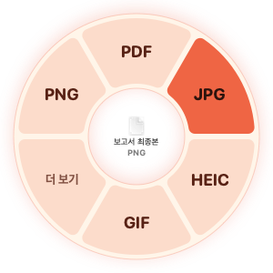

<p align="center">
  
</p>

<h1 align="center">Morphy</h1>

<p align="center">
  Finder에서 파일을 고르고 <b>Option(⌥)을 꾹</b> 누르면, 커서 옆에 뜨는 도넛 메뉴에서 바로 다른 형식으로 바꿔 주는 macOS 앱
</p>

<p align="center">
  <picture>
    <source media="(prefers-color-scheme: dark)" srcset="docs/images/menu-dark.png">
    
  </picture>
</p>

## 사용 방법

1. Finder나 바탕화면에서 파일을 **하나** 선택해요.
2. **Option(⌥)** 을 0.15초 꾹 누르면 커서 주변에 도넛 메뉴가 떠요.
3. Option을 누른 채 원하는 형식 칸 위로 커서를 옮기고 **손을 떼면** 변환돼요. 가운데 구멍이나 도넛 바깥에서 떼면 취소돼요.

- 결과 파일은 원본 바로 옆에 생겨요.
- 형식마다 칸 위치가 정해져 있어서, 익숙해지면 메뉴를 보지 않고도 고를 수 있어요.
- 칸을 지날 때 트랙패드가 가볍게 진동해요.
- 칸을 클릭해도 실행되고, Esc를 누르거나 도넛 바깥을 클릭하면 취소돼요. 바깥을 클릭해도 그 클릭은 Finder로 전달되지 않아요.

## 바꿀 수 있는 형식

| 원본 | 결과 |
|---|---|
| PNG, JPG, HEIC, TIFF, GIF, BMP, WEBP | PDF, JPG, PNG, HEIC, GIF, TIFF |
| SVG | 위와 같음. PDF는 벡터 그대로 |
| PDF | 페이지별 이미지, TXT |
| DOCX, DOC, ODT, RTF, TXT, Markdown | PDF, DOCX. Markdown은 HTML도 |
| XLSX, XLS, ODS, CSV | PDF, XLSX, CSV. 시트가 여러 개면 시트마다 CSV |
| PPTX, PPT, ODP | PDF, PPTX |

- WEBP로 **저장**은 `cwebp`가 설치된 Mac에서만 "더 보기"에 나와요. WEBP 파일을 JPG·PNG로 바꾸는 건 모든 Mac에서 돼요.
- 원본과 같은 형식은 메뉴에 나오지 않아요.
- 지원하지 않는 파일이나 여러 파일을 선택하면 메뉴가 뜨지 않아요.

## 안전하게

- **원본을 바꾸지 않아요.** 결과는 항상 새 파일로 만들고, 같은 이름이 있으면 `보고서 (1).pdf`처럼 번호를 붙여요.
- **확인한 결과만 저장해요.** 변환 결과를 다시 열어서 문제없을 때만 최종 파일로 저장해요.
- **내 Mac 안에서만 처리해요.** 파일을 업로드하지 않고, 계정이 없고, 사용 기록을 수집하지 않아요.
- **한국어 문서를 따로 검증했어요.** 한글 글꼴, CP949로 저장된 CSV·TXT, PDF 텍스트의 띄어쓰기를 확인했어요.

## 문서 변환 기능

Word·Excel·PowerPoint 문서를 변환하려면 처음 한 번 **문서 변환 기능(약 300MB)** 을 추가해요. 이미지와 PDF만 쓴다면 받지 않아도 돼요.

- 이 기능은 [LibreOffice](https://www.libreoffice.org)(The Document Foundation, MPL-2.0)를 공식 서버에서 받아 써요.
- 받은 파일은 앱에 고정된 SHA-256 해시와 TDF의 Apple 서명을 모두 확인한 뒤에 설치해요.
- 설치한 엔진은 Spotlight와 "다음으로 열기"에 나타나지 않아요.
- 이미 `/Applications`에 LibreOffice 26.8 이상이 있으면 그것을 써요.

자세한 내용은 [docs/engine-download.md](docs/engine-download.md)를 보세요.

## 요구 사항

- macOS 14 이상, Apple Silicon
- 손쉬운 사용 권한: Option 키 감지
- Finder 자동화 권한: 선택한 파일 읽기

## 개발

Windows 11 x64용 C#/.NET 앱도 별도 개발 중입니다. 현재 실행 가능한 기능과 빌드 방법은 [Windows 개발 안내](windows/README.md), 합의한 전체 범위는 [Windows 개발 명세](docs/windows.md)를 참고하세요.

Windows 설치 파일은 GitHub Actions에서 빌드하며, Mac에서 아티팩트를 받아 기존 Cloudflare Worker/R2로 배포합니다. [Mac에서 Windows 배포하기](docs/windows-deployment.md)를 참고하세요.

Xcode 없이 Command Line Tools만으로 빌드해요.

```bash
./build.sh              # build/Morphy.app
./build.sh --install    # /Applications에 설치하고 실행
./build.sh --selftest   # 변환, 저장, 엔진 검증 자체 테스트
./build.sh --dmg        # build/Morphy-<버전>.dmg
./build.sh --release    # Developer ID 서명, 공증, DMG (docs/release.md)
```

Office 문서까지 확인하려면 테스트 문서를 만들어 self-test에 넘겨요.

```bash
uv run scripts/make_corpus.py /tmp/corpus
build/Morphy.app/Contents/MacOS/Morphy --selftest /tmp/corpus
```

그 밖의 도구:

| 명령 | 하는 일 |
|---|---|
| `Morphy --convert <파일> <형식>` | 메뉴 없이 변환 하나를 실행 |
| `Morphy --render-menu <폴더>` | 메뉴 모양을 PNG로 저장 (라이트, 다크, 더 보기) |
| `Morphy --install-engine` | 문서 변환 기능을 명령줄에서 설치 |
| `swift scripts/make_icon.swift` | `assets/icon-source.webp`로 앱 아이콘을 다시 만듦 |

메뉴가 왜 안 뜨는지는 로그에서 볼 수 있어요.

```bash
/usr/bin/log stream --level info --predicate 'subsystem == "app.morphy.Morphy"'
```

## 구조

| 파일 | 역할 |
|---|---|
| `Sources/Morphy/Trigger.swift` | Option 꾹 누르기 감지, Finder 선택 읽기 |
| `Sources/Morphy/RadialMenu.swift` | 도넛 메뉴, 브랜드 색, 선택과 취소 |
| `Sources/Morphy/Convert.swift` | 형식과 경로, 입력 확인, 이미지·PDF·문서 변환, 안전 저장 |
| `Sources/Morphy/EngineInstaller.swift` | 문서 변환 기능 내려받기와 확인, 설치 |
| `Sources/Morphy/App.swift` | 메뉴바, 작업 대기열, 알림 |
| `Sources/Morphy/SelfTest.swift` | `--selftest` |
| `web/`, `src/`, `wrangler.jsonc` | 상세페이지와 다운로드 Worker (Cloudflare, R2, D1) |
| `scripts/publish-release.py` | Mac DMG와 Windows 설치 파일을 웹에 게시 |
| `DECISIONS.md` | 설계 결정 기록 (D1–D8) |
| `docs/` | 엔진 내려받기 설계, 웹 배포 절차 |

## 상태

개발 초기(0.1.0)예요. 아직 공증을 받지 않아서, 다른 Mac에서는 내려받은 앱이 경고 없이 열리지 않아요. 남은 일은 [docs/release.md](docs/release.md)에 있어요.
